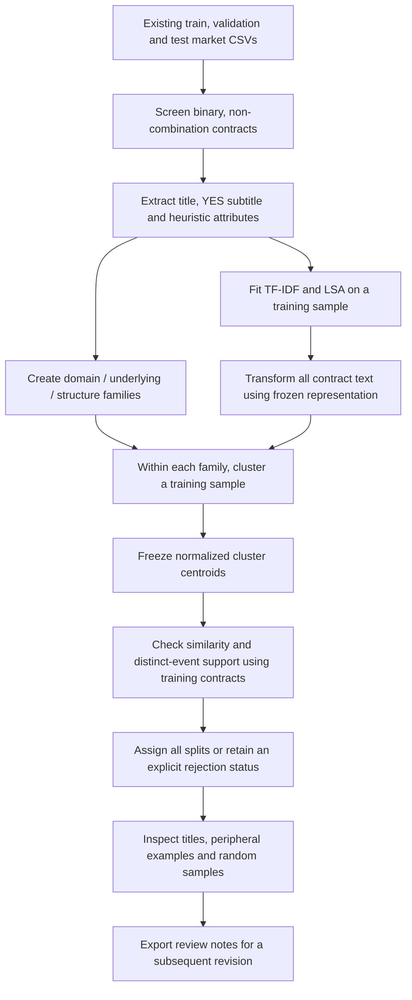

# Contract clustering methodology

This document describes the implemented CSV-based clustering workflow and the
LSA/hierarchical run inspected in the title-review tool. It is separate from the
older `mvp/` analysis, which used Parquet data and 16 global k-means clusters.

## Purpose

The aim is to create interpretable peer groups of Kalshi contracts for subsequent
mispricing analysis. Contracts should share a relevant subject and proposition
structure, as well as similar wording. A Bitcoin threshold contract should not
join a temperature threshold contract simply because both say “or above.”

Clustering does not estimate mispricing. It provides candidate populations within
which outcomes and purchase costs can later be compared. Membership is evidence
of similarity under the chosen rules and representation, not proof that two
contracts are economically equivalent or have the same fair probability.

## Workflow at a glance



The diagram describes the default LSA backend. An optional sentence-model backend
uses a local pretrained model in place of the TF-IDF/LSA steps.

## Structural rules and machine learning as a tree

The workflow combines explicit structural rules with **unsupervised machine
learning**. Rules define domain, underlying and contract structure; training-fitted
TF-IDF/LSA and hierarchical clustering discover finer text groups within those
boundaries. There are no outcome labels used to learn these groups.

The following tree shows selected branches and cluster IDs present in the saved
training run. It is a simplified membership tree, not an exhaustive inventory:

```text
Eligible Kalshi contracts
└── Domain                                      [structural rules]
    ├── Crypto
    │   └── Bitcoin (BTC)                       [structural rules]
    │       ├── Above-threshold contracts       [structural rules]
    │       │   ├── Cluster 000                 [learned text similarity]
    │       │   ├── Cluster 001                 [learned text similarity]
    │       │   └── Other learned clusters ...
    │       └── Interval contracts              [structural rules]
    │           ├── Cluster 000                 [learned text similarity]
    │           └── Other learned clusters ...
    ├── Weather
    │   └── Chicago high temperature (HIGHCHI)   [structural rules]
    │       └── Interval contracts              [structural rules]
    │           ├── Cluster 000                 [learned text similarity]
    │           └── Other learned clusters ...
    └── Sports
        └── College football (NCAAF)             [structural rules]
            └── Spread contracts                [structural rules]
                └── Cluster 000                 [learned text similarity]
```

For example, `crypto/BTC/above/000` is a path through this tree. Numeric suffixes
are local to a family: `above/000` and `interval/000` are different groups.
Contracts with no supported, sufficiently similar group remain unassigned within
their family; the diagram omits those rejection branches for readability.

There is also an actual **hierarchical merge tree**, called a dendrogram, inside
each training-sample family fit: average-linkage clustering merges nearby text
groups until the selected cutoff defines the final groups. That detailed tree is
not currently exported. Final assignments use the resulting frozen centroids,
so the membership tree above is a useful overview rather than the full fitted
dendrogram or a supervised decision tree.

## 1. Input data and eligibility

The workflow reads these files only:

```text
data/kalshi_recent_year_csv/split/train/markets.csv
data/kalshi_recent_year_csv/split/validation/markets.csv
data/kalshi_recent_year_csv/split/test/markets.csv
```

It does not read the Parquet datasets, master CSV, or trade CSVs. Loaded columns
are ticker, event ticker, market type, title, YES subtitle, opening time and closing
time. Times are retained for inspection but are not used in clustering.

Contracts must have binary market type, a nonblank title and a nonblank event ID.
Tickers beginning with `KXMVE` or `MVE` are excluded because combination products
require information about their underlying legs. The loader stops on duplicate
tickers or event IDs appearing in more than one split.

There is no resolved-only filter, first-day trading requirement or minimum market
lifetime restriction in this workflow. Final outcomes, status, prices, volume and
trading activity are not used to select or group contracts. These restrictions
would need separate consideration when constructing later mispricing targets.

## 2. Preserve the supplied splits

The existing dataset manifest describes a seeded event-level hash split of
approximately 70% train, 20% test and 10% validation. Clustering preserves those
assignments and checks retained event IDs for overlap.

Training contracts determine the learned representation, hierarchies, centroids
and support decisions. Validation and test contracts are transformed and assigned
using those frozen rules. Their wording does not fit the LSA vocabulary or SVD.

These are event-disjoint splits, not chronological or unseen-series splits.
Recurring series can appear on both sides, and different event IDs can still
refer to related underlying outcomes. This design does not establish that an
actual historical deployment could have made the same predictions.

## 3. Construct text and structured attributes

Each contract's text is its title followed by its YES subtitle. For example:

```text
Title:        Bitcoin price on Nov 17, 2025?
YES subtitle: $94,750 or above
Combined:     Bitcoin price on Nov 17, 2025? $94,750 or above
```

The subtitle often contains the strike, interval or named alternative that makes
the proposition specific. The viewer displays title and subtitle separately.

Transparent rules assign three attributes:

| Attribute | Implemented treatment |
| --- | --- |
| Domain | Recognized crypto names, temperature wording, equity-index wording, selected sports series prefixes and mention series; otherwise unknown. |
| Underlying | BTC/ETH/DOGE, SP500/NASDAQ100, weather series identity, or recognized sports league/tour. Unrecognized cases fall back to series identity. |
| Structure | Ordered rules for spread, total, interval, above, below and winner; otherwise unknown. The YES subtitle is preferred for threshold/interval detection. |

The series identifier is the portion of `event_ticker` before the first hyphen,
with an initial `KX` removed. For unknown structures and sports above/below props,
the underlying falls back to series identity. This helps avoid pooling different
player-prop mechanisms solely because they share a sport.

The code also exports literal number tokens from the subtitle, heuristic units,
and a lowercased template with numbers replaced by `[number]`. These are review
fields: **the template, units and extracted numbers do not enter a separate
numerical distance calculation**. Raw numbers and dates remain in the text passed
to the encoder; the default tokenizer does not guarantee faithful numerical
representation. Settlement source is explicitly recorded as unknown.

These rules are heuristics, not an authoritative category taxonomy, validated
entity extractor, settlement-rule parser or complete economic event graph.

## 4. Establish economic family boundaries

A family has the form:

```text
domain / underlying / structure
crypto / BTC / above
crypto / BTC / interval
weather / HIGHCHI / interval
sports / NCAAF / spread
```

Only members of the same family can share a final cluster. These are hard
boundaries: even identical text vectors cannot join contracts across families.
They protect important distinctions, but a mistaken rule can also incorrectly
separate useful peers or admit inappropriate members.

An exact event ID is retained to count independent event support. It is not a
semantic feature. Recurring series identity influences family construction in
the cases described above.

## 5. Represent text numerically

### Default: TF-IDF and latent semantic analysis

A deterministic sample of up to 20,000 training contracts fits the text model.
Sampling sorts tickers by SHA-256 of `340:<ticker>` and takes the first entries;
it is not a volume-ranked or outcome-based selection.

TF-IDF represents words and two-word phrases, with sublinear term-frequency
scaling, a maximum vocabulary of 20,000 features and a minimum document frequency
of two in the fitting sample. Scikit-learn's default lowercasing and tokenization
apply. Truncated SVD compresses the matrix into up to 64 LSA dimensions, bounded
also by sample size and vocabulary size. The random seed is 340.

All contracts are transformed using this fitted vocabulary and SVD. Vectors are
normalized to unit length, so their dot product is cosine similarity. Transforming
in batches of 10,000 limits peak dense memory. Zero vectors are excluded from
hierarchy fitting and cannot satisfy the default positive assignment threshold.

LSA captures lexical co-occurrence. It can respond to shared dates, strikes and
phrasing without establishing economic substitutability. It is not a pretrained
sentence embedding model.

### Optional: sentence embeddings

`--backend sentence --model /local/checkpoint` loads a local Sentence Transformers
model on CPU, embeds the same title/subtitle text and normalizes the vectors.
There is no automatic model download or fallback. The local checkpoint must be
available and its revision should be recorded when acquired.

This backend is implemented, but the saved run reviewed here uses **LSA**. No
sentence-model comparison or improvement claim is established by these results.

## 6. Fit a hierarchy within each family

For each family, up to 1,000 training contracts are selected using the same stable
hash sampling rule. This bounds the quadratic cost of hierarchical clustering.
Families with fewer than two usable sampled vectors cannot form groups.

The default algorithm is agglomerative clustering with average linkage and cosine
distance. It starts with individual sampled contracts and merges groups based on
the average pairwise distance between their members. A distance cutoff of 0.35
controls the final resolution; the number of clusters is not fixed in advance.

For nonzero normalized vectors:

```text
cosine_similarity(x, y) = x · y
cosine_distance(x, y)   = 1 - cosine_similarity(x, y)
```

The linkage cutoff is an average-distance criterion. It does not guarantee that
every pair of members has similarity at least 0.65.

Each preliminary cluster is represented by the normalized mean of its sampled
training vectors. These centroids are frozen; they are not recomputed using all
training contracts or any held-out contracts.

## 7. Check training support and assign contracts

All training contracts in the family are compared with the frozen centroids.
Each selects its closest centroid and must have cosine similarity of at least
0.75. A centroid is supported only when those close training matches include at
least 20 contracts and 10 distinct event IDs.

Every contract, including the sampled training contracts, then receives its
nearest-centroid assignment subject to the same similarity cutoff and training
support decision. Consequently, final membership can differ from the sampled
hierarchy's original leaf membership. This is a centroid-based extension of the
hierarchy, rather than a full hierarchy fitted to all 278,836 contracts.

| Status | Meaning |
| --- | --- |
| `assigned` | Closest centroid passes similarity and training-support checks. |
| `distant` | No sufficiently close nearest-centroid match under the threshold. |
| `insufficient_training_support` | The nearest close group lacks support, or the family has too few usable fitting vectors. |
| `unseen_family` | No training contracts exist for that family. |

When the closest group is unsupported, the contract stays unassigned. The code
does not search for a more distant supported alternative. Unseen families have
no similarity score; families too small to fit can also have missing scores.

A cluster ID such as `crypto/BTC/above/000` identifies the family and a local
numeric label. Numeric suffixes are not rankings, probability levels or stable
identities across parameter changes.

## 8. Compare against k-means

`--method kmeans` retains the same input filters, family boundaries, representation,
training samples, nearest-centroid assignment and rejection rules. Within each
family it fits up to eight clusters, capped at the number of distinct sampled
vectors, using ten starts and seed 340.

This comparison isolates the within-family grouping algorithm more closely than
comparing with the older MVP's global k-means. Different partitions can still
produce different eligible populations. Better coverage alone is not proof of
better economic coherence or better downstream mispricing estimates.

## 9. Inspect and document title coherence

The pipeline exports three central, three peripheral and three deterministic
hash-sampled examples per assigned cluster and split, where available. The
interactive viewer allows inspection of all contracts, including unassigned ones.

A practical manual review proceeds as follows:

1. Start with training groups ordered by weakest mean similarity.
2. Read peripheral titles, then central titles and a random sample. Keep the YES
   subtitle visible so that different strikes and named alternatives are apparent.
3. Ask whether the titles share an economic subject and proposition mechanism,
   rather than merely sentence structure. Check above/below direction, intervals,
   different sports props and repeated dates or entities.
4. Record coherent groups, mixed groups, possible splits and possible merges.
   Name concrete misplaced titles in the notes rather than recording only a score.
5. Inspect unassigned contracts for systematic omissions or useful excluded families.
6. Use validation examples to assess transfer. Freeze further changes before
   downstream evaluation on test outcomes.

Reviews are saved explicitly in the browser and can be exported to JSON. They do
not automatically alter assignments. A reviewed correction requires a subsequent
change to extraction rules, representation or grouping settings, followed by a new
run. Looking at titles is useful qualitative validation, but cannot establish
predictive accuracy or economic equivalence.

## 10. Saved run and outputs

The completed default run currently stored in `output/clustering/` has:

| Split | Input contracts | Retained contracts | Assigned contracts | Assigned groups |
| --- | ---: | ---: | ---: | ---: |
| Train | 369,507 | 194,378 | 169,195 | 429 |
| Validation | 54,018 | 28,271 | 24,547 | 418 |
| Test | 105,782 | 56,187 | 48,744 | 428 |
| Total | 529,307 | 278,836 | 242,486 | — |

About 87% of retained contracts are assigned. Group counts across splits overlap;
they must not be added together. Counts describe this local extract and these
settings, not a permanent property of Kalshi markets.

| Output | Use |
| --- | --- |
| `assignments.csv` | One row per retained contract, including attributes, group, status and similarity. |
| `cluster_profiles.csv` | Contract/event/series counts and mean centroid similarity by group and split. |
| `review_examples.csv` | Central, peripheral and deterministic sampled examples. |
| `coverage.csv` | Counts for each assignment status and split. |
| `run_manifest.json` | Configuration, seed, input file paths/sizes/mtimes, screening counts and completion flag. |
| `title-review.html` | Generated offline title browser; created separately by the viewer command. |

Mean similarity measures compactness in the learned text space. It is not a
calibrated confidence score. Event and contract counts reported in profiles are
split-specific; the viewer further restricts displayed counts to its active filters.

## Reproduction

From the repository root, using the project's installed environment:

```bash
# Default LSA + hierarchical workflow; replaces named outputs in this directory.
.venv/bin/python -m extension.clustering.pipeline

# Generate the data-bearing viewer after a successful run.
.venv/bin/python -m extension.clustering.viewer

# Matched k-means comparison in a separate directory.
.venv/bin/python -m extension.clustering.pipeline \
  --method kmeans --output output/clustering_kmeans

# Focused correctness checks.
.venv/bin/python -m pytest tests/extension/clustering -q
```

Open **`output/clustering/title-review.html`**, not the source template at
`extension/clustering/viewer.html`. Check `completed: true` in the run
manifest before interpreting generated tables as a completed analysis.

Default settings are initial engineering choices, not tuned or validated optimums.
The stable hash samples and fixed seeds aid reproduction. The current manifest
records file metadata rather than raw-data hashes, dependency versions or complete
model artifacts. The pipeline recomputes learned transforms on each invocation;
for stronger provenance, retain the code revision, environment and exact data/model
snapshot alongside each run. Platform/library changes can affect numerical results.

## Limits and use in mispricing analysis

The principal remaining limits are heuristic family rules, incomplete settlement
information, imperfect handling of negation and numerical distances, sampled
hierarchies, and economic dependence not captured by event IDs. The same latest
snapshot wording is used regardless of whether it was historically available at
a proposed prediction time.

For downstream analysis, join assignments to the **CSV** trades by ticker, restrict
predictors to a defensible observation window, and compare outcomes at matched
purchase costs. Preserve event dependence in uncertainty estimates. A group can
have many contracts but few independent resolutions; clustering does not remove
that dependence. Contract-balanced versus execution-weighted estimates also
answer different questions and should be chosen explicitly.

Assess coverage, stability, manual coherence and independent-event support before
claiming improvement in mispricing estimation. A fresh chronological evaluation,
with known historical metadata and outcome-publication times, is needed for a
future-prediction claim. No trading profitability or causal wording effect is
established by these clusters.

## Implementation references

- [Attribute extraction](features.py)
- [Loading, representation, grouping and output generation](pipeline.py)
- [Viewer generator](viewer.py)
- [Commands and review instructions](README.md)
- [Focused tests](../../tests/extension/clustering/)
