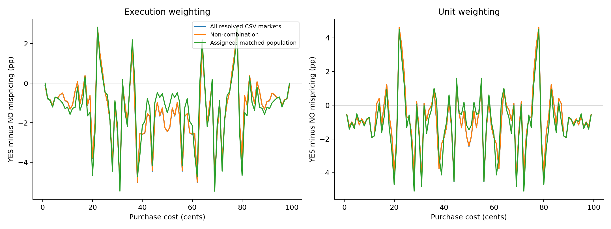
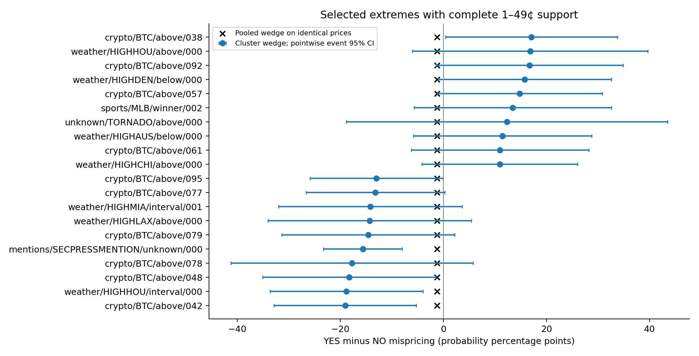
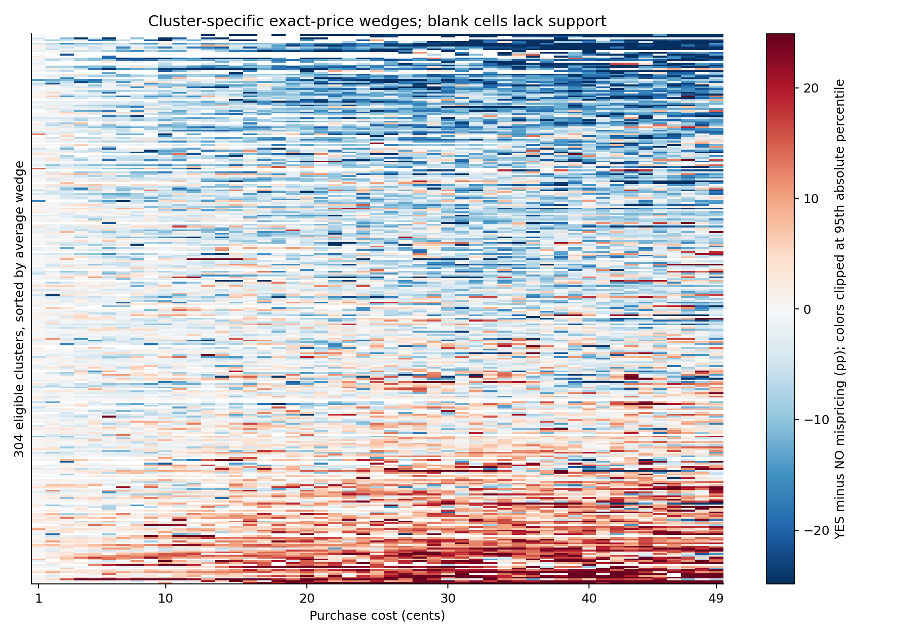

# Does the YES/NO mispricing wedge vary across similar-contract clusters?

## Findings

**The pooled YES disadvantage remains, and a few contract types differ from that average.
However, the primary execution-weighted tests do not establish additional variation among
learned subclusters within the same structural family.** A secondary unit-weighted common-support
test does find within-family variation, so that lead depends on weighting and needs new-data validation.
The most dramatic observed cluster wedges should not be treated as precise estimates.

The recent-year CSV analysis contains **238,601 resolved, volume-screened assigned contracts**.
Of the learned clusters, **304** have enough bilateral exact-price support for the primary summary.
The frozen assignments contain **429 groups**, of which **427** contribute eligible resolved trades;
remaining groups or prices are omitted from supported summaries rather than assigned zero wedges.
Their observed standardized wedges range from **-53.03 to 31.46 probability percentage points**.
These extremes alone are descriptive: some groups have different price support and some estimates are imprecise.

A direct equal-wedge test on the **211 clusters with complete 1–49¢ support**
has event-level p = **0.0930**. Centering within structural families instead
compares **155 clusters** and gives p = **0.8659**.
These tests compare cluster wedges directly on the same prices, rather than relying on
cluster-versus-pooled contrasts alone.

Against the ungrouped baseline built from exactly the assigned population and matched prices,
**7 of 304 clusters differ at event-level FDR 5%**, and
**4** survive the more stringent joint event max-T adjustment.
The global event max-T p-value is **0.0001** (simulation resolution 0.0001).
Using market-level rather than event-level uncertainty, **3** pass FDR 5%.

To separate learned subgroup variation from broad family differences, clusters were also compared
with their own structural parent on the same exact prices. **0** survive
joint event max-T adjustment in that comparison; **0** also pass market-level FDR.
This is the more direct check of whether learned subgroups add information beyond the structural parents.
One apparently strong pooled result, `sports/NFLWINS/above/000`, has zero estimated
cluster-level event variance: all its retained direction/price cells have boundary win rates.
Its asymptotic p-value is not credible evidence of a precisely known zero wedge. The raw test counts
above include this flagged case; it should not be promoted as an established discovery.

All tests are exploratory, conditional on the fixed grouping and support rules; they do not establish
causal framing effects, persistent predictability or profitable trading.

## Source methodology and what was reproduced

The source is Jonathan Becker, *The Microstructure of Wealth Transfer in Prediction Markets*,
the original PDF in the repository root, rather than the MVP or the recreated article/figure scripts.
PDF page 6 (printed page 5), Equation (1), defines mispricing as realized win rate minus implied probability.
PDF page 11 (printed page 10), Section 6.3 and Equation (3), defines the same-cost YES/NO wedge.
Section 5.1 and Figure 5 report gross excess returns by direction and price.

For price c, group g and direction d:

```text
q[g,c,d]     = sum(weight × resolved payoff) / sum(weight)
delta[g,c,d] = q[g,c,d] - c/100
Delta[g,c]   = delta[g,c,YES] - delta[g,c,NO]
report pp    = 100 × Delta[g,c]
return %     = 100 × (100 × q[g,c,d] - c) / c
```

Each execution supplies one YES position at yes_price and one NO position at no_price;
their payoffs are y and 1-y. Both execution roles are pooled. This does not assume that one
trader bought both sides. Negative Delta means a YES disadvantage; positive means a NO disadvantage.

Primary weighting is one observation per execution per direction, consistent with the paper's
mean-per-trade formulation. The unit-weighted sensitivity uses trade `count`, matching the repository's
`ev_yes_vs_no.py` implementation. That script is not substituted for the PDF's complete methodology.
Neither weighting uses notional dollars as the outcome weight. All results are gross of fees.

A probability-point wedge is different from a return-percentage gap: at 1¢, a 0.64-point wedge
corresponds to a 64% gross-return gap, while at 50¢ it corresponds to 1.28%.
The original full-sample 1¢ returns (about -41% YES and +23% NO) are context, not replication targets
for a different time window and selected population.

## CSV sample and comparable pooled baselines

Only `data/kalshi_recent_year_csv/master/markets.csv`, `master/trades.csv`, and the frozen
`output/clustering/assignments.csv` were read. No Parquets and no MVP code/results are used.
The extraction audited **65,017,902 trade rows**, **65,017,902 distinct IDs**,
and **267,291 invalid executions**. Missing or repeated IDs stop the pipeline;
invalid prices, complementary-price inconsistencies, nonpositive sizes and invalid taker sides are excluded.

Markets must be finalized, binary and resolved YES/NO. The paper's $100 minimum notional-volume
screen is implemented as at least 100 traded units in the observed CSV window: complementary
positions together cost $1 per unit, consistent with the repository's `volume_over_time.py` convention.
The PDF does not fully specify every extraction detail; this is a documented implementation choice.
The recent-year window can truncate older contracts' activity, so this is not a full historical replication.
Unlike the MVP, there is no first-24-hour restriction or five-early-trade requirement.

| population | contracts | events | executions | units |
| --- | --- | --- | --- | --- |
| all_resolved | 351452 | 100945 | 60451460 | 15,155,404,893.000 |
| non_combination | 266517 | 49843 | 60293601 | 15,100,842,364.000 |
| assigned_matched | 238601 | 45476 | 52427659 | 13,298,457,214.000 |

Three ungrouped curves expose selection effects: all eligible markets (including combinations),
non-combination markets, and precisely the assigned population. The first is the closest available
paper-style baseline; only the third is the direct reference for cluster comparisons.
Unknown/void/open markets do not contribute outcomes. Combination products are excluded from
cluster inference, but retained in the broad baseline when otherwise eligible.



Mean and range of pooled exact-price wedges across 1–49¢ (equal weight per cost):

| population | weighting | mean | min | max |
| --- | --- | --- | --- | --- |
| all_resolved | execution | -1.237 | -5.086 | 2.810 |
| all_resolved | unit | -0.867 | -4.514 | 4.585 |
| assigned_matched | execution | -1.235 | -5.462 | 2.819 |
| assigned_matched | unit | -1.019 | -5.093 | 4.497 |
| non_combination | execution | -1.225 | -5.065 | 2.830 |
| non_combination | unit | -0.855 | -4.494 | 4.626 |

Selected exact-price results from the execution-weighted broad CSV baseline:

| cost | direction | mispricing_pp | return_pct | contracts | events |
| --- | --- | --- | --- | --- | --- |
| 1 | NO | -0.050 | -4.960 | 67081 | 31660 |
| 1 | YES | -0.170 | -17.034 | 108046 | 42535 |
| 5 | NO | -0.372 | -7.445 | 45434 | 26688 |
| 5 | YES | -1.103 | -22.064 | 71185 | 33896 |
| 10 | NO | -0.449 | -4.493 | 44391 | 26840 |
| 10 | YES | -1.378 | -13.780 | 66919 | 33332 |
| 25 | NO | -1.891 | -7.566 | 45959 | 27134 |
| 25 | YES | -2.337 | -9.347 | 62867 | 32341 |
| 50 | NO | 1.227 | 2.455 | 65618 | 31184 |
| 50 | YES | -1.227 | -2.455 | 65618 | 31184 |

For a direct numerical comparison with the paper, here is the 1¢ result in its gross-return units:

| sample/weight | YES return % | NO return % | YES minus NO return pp |
| --- | --- | --- | --- |
| Original paper, full historical sample (reported) | -41.000 | 23.000 | -64.000 |
| Recent-year CSV, execution weighted | -17.034 | -4.960 | -12.074 |
| Recent-year CSV, unit weighted | -27.569 | 27.985 | -55.554 |

The first row is the paper's rounded, reported full-sample result, not recalculated from unavailable
full-history CSVs. The next two rows rerun the same-cost direction comparison on the recent-year CSVs.
The unit-weighted row follows the repository's figure weighting; the execution-weighted row follows
the mean-per-trade convention used for this report's primary analysis. Differences in sample period,
screening and weight convention prevent interpreting numerical closeness as an exact replication.

Full 1–99¢ curves, including return-percentage equivalents, are in [pooled_curves.csv](results/pooled_curves.csv).
Differences from the paper can reflect time, eligibility, weighting and composition; they cannot
be attributed to clustering itself.

## Price matching and supported cluster summaries

The paper defines an exact-price curve, not a single cluster-level scalar. The following
standardized summaries are extensions for comparing curves, explicitly separated from that replication:

- Retain an exact cost only if each direction has at least **20 distinct contracts and 10 event IDs**.
- Primary summary: equal-cost mean of Delta over supported costs from **1–49¢**, requiring at least 10 costs.
- Additional bands: 1–10, 11–20, 21–30, 31–40 and 41–49¢, each requiring at least six costs.
- Compare the cluster with the pooled or parent-family curve averaged over **identical retained costs**.
  Support is determined without using realized win rates or significance.
- Unsupported costs are missing, never zero mispricing. Raw exact-price curves are still exported.

For all-side pooling, Delta(c) = Delta(100-c) exactly. Thus 51–99¢ duplicate 1–49¢,
and 50¢ is a special twice-YES-calibration contrast. Full curves are exported, but neither
those mirrored observations nor 50¢ are counted as additional evidence in the summaries.
Equal-cost averaging avoids giving the YES and NO samples different price mixtures.

**211 clusters have complete support at all 49 primary prices**.
For this common-support subset, observed wedges range from **-19.05 to 17.07 pp**
with cross-cluster sample SD **6.72 pp**. These are directly comparable observed
levels, but their dispersion still includes sampling noise and is not a latent variance estimate.



Selected extreme groups are shown for interpretation, not selected as trading opportunities.
Pointwise confidence intervals for wedge levels differ from simultaneous inference for contrasts.

| cluster | events | n_costs | wedge_pp | pooled_matched_pp | difference_pp | q_event | p_event_maxT | 95% CI |
| --- | --- | --- | --- | --- | --- | --- | --- | --- |
| crypto/BTC/above/042 | 130 | 49 | -19.047 | -1.235 | -17.812 | 0.290 | 0.967 | [-32.84, -5.25] |
| weather/HIGHHOU/interval/000 | 65 | 49 | -18.795 | -1.235 | -17.560 | 0.358 | 0.998 | [-33.61, -3.98] |
| crypto/BTC/above/048 | 211 | 49 | -18.240 | -1.235 | -17.005 | 0.390 | 1.000 | [-35.03, -1.45] |
| crypto/BTC/above/078 | 70 | 49 | -17.730 | -1.235 | -16.495 | 0.638 | 1.000 | [-41.23, 5.77] |
| mentions/SECPRESSMENTION/unknown/000 | 42 | 49 | -15.607 | -1.235 | -14.372 | 0.014 | 0.076 | [-23.24, -7.97] |
| crypto/BTC/above/079 | 174 | 49 | -14.557 | -1.235 | -13.322 | 0.566 | 1.000 | [-31.33, 2.22] |
| weather/HIGHLAX/above/000 | 321 | 49 | -14.312 | -1.235 | -13.077 | 0.638 | 1.000 | [-34.03, 5.41] |
| weather/HIGHMIA/interval/001 | 138 | 49 | -14.153 | -1.235 | -12.918 | 0.638 | 1.000 | [-31.97, 3.67] |
| crypto/BTC/above/077 | 239 | 49 | -13.169 | -1.235 | -11.934 | 0.520 | 1.000 | [-26.61, 0.27] |
| crypto/BTC/above/095 | 224 | 49 | -12.964 | -1.235 | -11.729 | 0.485 | 1.000 | [-25.86, -0.06] |
| weather/HIGHCHI/above/000 | 336 | 49 | 10.955 | -1.235 | 12.190 | 0.566 | 1.000 | [-4.14, 26.05] |
| crypto/BTC/above/061 | 132 | 49 | 10.998 | -1.235 | 12.233 | 0.638 | 1.000 | [-6.21, 28.20] |
| weather/HIGHAUS/below/000 | 337 | 49 | 11.467 | -1.235 | 12.702 | 0.631 | 1.000 | [-5.83, 28.76] |
| unknown/TORNADO/above/000 | 12 | 49 | 12.353 | -1.235 | 13.588 | 0.838 | 1.000 | [-18.78, 43.49] |
| sports/MLB/winner/002 | 308 | 49 | 13.451 | -1.235 | 14.686 | 0.566 | 1.000 | [-5.66, 32.56] |
| crypto/BTC/above/057 | 138 | 49 | 14.827 | -1.235 | 16.062 | 0.390 | 1.000 | [-1.18, 30.84] |
| weather/HIGHDEN/below/000 | 326 | 49 | 15.785 | -1.235 | 17.020 | 0.390 | 1.000 | [-1.03, 32.60] |
| crypto/BTC/above/092 | 139 | 49 | 16.717 | -1.235 | 17.952 | 0.390 | 1.000 | [-1.40, 34.84] |
| weather/HIGHHOU/above/000 | 65 | 49 | 16.826 | -1.235 | 18.061 | 0.566 | 1.000 | [-6.02, 39.67] |
| crypto/BTC/above/038 | 92 | 49 | 17.066 | -1.235 | 18.301 | 0.384 | 1.000 | [0.40, 33.74] |



## Which differences deserve follow-up?

Execution-weighted clusters passing the exploratory event-FDR screen:

| cluster | n_costs | wedge_pp | difference_pp | q_event | q_market | p_event_maxT | degenerate_event_variance |
| --- | --- | --- | --- | --- | --- | --- | --- |
| crypto/ETH/interval/008 | 39 | -12.719 | -11.372 | 0.027 | 0.498 | 0.169 | False |
| mentions/SECPRESSMENTION/unknown/000 | 49 | -15.607 | -14.372 | 0.014 | 0.060 | 0.076 | False |
| sports/NFLANYTD/unknown/000 | 48 | -16.132 | -14.902 | 0.007 | 0.020 | 0.027 | False |
| sports/NFLFIRSTTD/unknown/000 | 13 | -23.769 | -22.182 | 0.000 | 0.000 | 0.000 | False |
| sports/NFLWINS/above/000 | 12 | 0.000 | 0.957 | 0.000 | 0.613 | 0.000 | True |
| sports/PGA/winner/001 | 32 | -14.684 | -13.360 | 0.007 | 0.946 | 0.020 | False |
| unknown/SPOTIFYD/unknown/001 | 22 | 13.204 | 14.234 | 0.027 | 0.843 | 0.179 | False |

Two concrete contract-family comparisons are:

- `sports/NFLANYTD/unknown/000`: wedge -16.13 pp over 48 costs; event max-T p=0.0272, market FDR q=0.0204.
- `sports/NFLFIRSTTD/unknown/000`: wedge -23.77 pp over 13 costs; event max-T p=0.0001, market FDR q=0.0000.

These are distinct contract families, each represented here by cluster 000; they do not
by themselves demonstrate that NLP-discovered subdivisions improve on the structural grouping.
Narrower-support products describe different purchase-cost sets than the all-49-cost cohort.

The smallest observed wedge is `sports/MLB/winner/000` at -53.03 pp, with
event SE 21.45 pp and event FDR q=0.340.
Large observed values must be assessed alongside uncertainty, not ranked by magnitude alone.

## Variation beyond the structural parents

Parent references pool assigned siblings in the same domain/underlying/structure family.
They include the focal cluster, so contrasts are correlated and must use paired uncertainty.
For a family with only one contributing cluster, its cluster-parent contrast is identically zero.
Representative comparisons (complete-support groups first, ordered by adjusted event p-value):

| cluster | n_costs | wedge_pp | pooled_matched_pp | difference_pp | q_event | q_market | p_event_maxT |
| --- | --- | --- | --- | --- | --- | --- | --- |
| crypto/BTC/interval/015 | 49 | 5.117 | -2.273 | 7.390 | 0.401 | 0.835 | 0.783 |
| unknown/MLSGAME/winner/002 | 49 | -7.494 | -3.180 | -4.314 | 0.414 | 1.000 | 0.920 |
| crypto/BTC/above/042 | 49 | -19.047 | -1.571 | -17.476 | 0.415 | 0.776 | 0.964 |
| crypto/BTC/interval/011 | 49 | 6.236 | -2.273 | 8.509 | 0.415 | 0.984 | 0.968 |
| crypto/BTC/interval/005 | 49 | 4.509 | -2.273 | 6.782 | 0.456 | 0.984 | 0.994 |
| sports/MLB/winner/001 | 49 | -3.843 | 0.381 | -4.224 | 0.456 | 1.000 | 0.995 |
| crypto/BTC/above/011 | 49 | 10.373 | -1.571 | 11.944 | 0.479 | 0.835 | 0.999 |
| crypto/BTC/above/053 | 49 | -11.125 | -1.571 | -9.554 | 0.479 | 0.835 | 1.000 |
| crypto/BTC/above/051 | 49 | 7.931 | -1.571 | 9.503 | 0.479 | 0.835 | 1.000 |
| crypto/BTC/above/038 | 49 | 17.066 | -1.571 | 18.638 | 0.479 | 0.835 | 1.000 |
| crypto/BTC/above/062 | 49 | 9.584 | -1.571 | 11.155 | 0.521 | 0.835 | 1.000 |
| sports/NBA/winner/000 | 49 | 5.600 | 0.119 | 5.481 | 0.521 | 1.000 | 1.000 |

The reference column `pooled_matched_pp` means the matched **parent** in family-reference rows.
Cluster IDs are identifiers, not economic labels. The complete summary CSV includes representative
title/subtitle text to help interpret each group without guessing from its numeric suffix.

## Statistical uncertainty and multiple comparisons

The analysis uses an analytic ratio-estimator influence function, aggregating all repeated
positions by `event_ticker` for event-level sandwich standard errors. Market-level sandwiches
use ticker instead. The cluster and its reference share observations, so their influence functions
are subtracted before calculating the contrast's variance; independent-sample errors would be wrong.
Both directions and all exact costs remain correlated through their shared outcomes.

Two-sided normal-approximation p-values are adjusted using Benjamini–Hochberg FDR within each
weighting/reference/band comparison family. A joint Gaussian max-T simulation (10,000 draws,
seed 340), using the estimated event-level cross-cluster covariance, supplies a global check,
familywise-adjusted cluster p-values and simultaneous contrast intervals. This is asymptotic
inference, not a raw-trade bootstrap or a finite-sample randomization test. BH control is not
guaranteed under arbitrary dependence; the correlated max-T results provide a complementary check.
Secondary bands and weighting choices are reported separately, not collectively corrected as one
preregistered experiment. Do not choose a favorable band after reading its results.

| weighting | reference | band | clusters | global_maxT_p | maxT_critical | event_fdr_05 | market_fdr_05 | maxT_05 | full_support_clusters |
| --- | --- | --- | --- | --- | --- | --- | --- | --- | --- |
| execution | pooled | 1-49 | 304 | 0.000 | 3.774 | 7 | 3 | 4 | 211 |
| execution | pooled | 1-10 | 262 | 0.000 | 3.731 | 9 | 5 | 6 | 227 |
| execution | pooled | 11-20 | 260 | 0.000 | 3.708 | 2 | 4 | 1 | 230 |
| execution | pooled | 21-30 | 269 | 0.031 | 3.737 | 1 | 0 | 1 | 243 |
| execution | pooled | 31-40 | 285 | 0.000 | 3.738 | 4 | 0 | 1 | 259 |
| execution | pooled | 41-49 | 294 | 0.532 | 3.747 | 0 | 0 | 0 | 280 |
| execution | family | 1-49 | 304 | 0.053 | 3.736 | 0 | 0 | 0 | 211 |
| unit | pooled | 1-49 | 304 | 0.045 | 3.738 | 0 | 0 | 1 | 211 |
| unit | pooled | 1-10 | 262 | 0.136 | 3.741 | 0 | 0 | 0 | 227 |
| unit | pooled | 11-20 | 260 | 0.006 | 3.736 | 1 | 0 | 1 | 230 |
| unit | pooled | 21-30 | 269 | 0.096 | 3.716 | 0 | 0 | 0 | 243 |
| unit | pooled | 31-40 | 285 | 0.008 | 3.747 | 4 | 0 | 1 | 259 |
| unit | pooled | 41-49 | 294 | 0.088 | 3.749 | 0 | 2 | 0 | 280 |
| unit | family | 1-49 | 304 | 0.059 | 3.740 | 2 | 0 | 0 | 211 |

Win rates exactly zero or one can make empirical sandwich variances collapse. The summary
exports `boundary_price_cells` and `degenerate_event_variance` to make this limitation visible.
No continuity adjustment or pseudo-outcomes are silently added. Normal-approximation tests
are particularly unreliable in these boundary cases.

Minimum event counts do not guarantee a large effective sample when executions or units are
concentrated in a few events. Event IDs do not capture every shared underlying outcome.
Groups, price support and the resolved population are treated as fixed: uncertainty excludes
learned-cluster instability, support selection and historical metadata revisions.

## Direct equality of cluster wedges on common support

The strongest check of heterogeneity restricts to clusters supported at all 49 costs,
then tests whether their equal-cost wedges are identical. The statistic is the largest
absolute standardized deviation from the unweighted cluster mean. A second version
centers within structural families and excludes families with only one complete-support
cluster. Gaussian simulation uses the full event- or market-cluster covariance of those
centered contrasts. These tests avoid differences in each cluster's price support and
direction-specific composition of a trade-weighted pooled reference.

| weighting | dependence_unit | question | tested_clusters | p_value | observed_max_z |
| --- | --- | --- | --- | --- | --- |
| execution | event_id | all_clusters | 211 | 0.093 | 3.516 |
| execution | event_id | within_structural_family | 155 | 0.866 | 2.467 |
| execution | ticker | all_clusters | 211 | 0.172 | 3.327 |
| execution | ticker | within_structural_family | 155 | 0.491 | 2.849 |
| unit | event_id | all_clusters | 211 | 0.059 | 3.636 |
| unit | event_id | within_structural_family | 155 | 0.029 | 3.709 |
| unit | ticker | all_clusters | 211 | 0.059 | 3.651 |
| unit | ticker | within_structural_family | 155 | 0.029 | 3.735 |

For the primary execution-weighted cohort, the event-level all-cluster test gives p=0.0930
and the within-family test gives p=0.8659. Unit weighting yields
within-family p=0.0287 with event errors and p=0.0291 with market errors. This is a potentially
useful but secondary, weighting-sensitive result, not consistent evidence across definitions.
These are global tests; they do not identify a validated individual subgroup or trading rule.
The cohort excludes clusters without complete price support, so a non-rejection here does
not negate differences in narrower-support products such as first-touchdown contracts.

The all-cluster and within-family questions, weights and dependence units are reported
as separate exploratory checks; they are not a single preregistered family of tests.

## Weighting sensitivity and split interpretation

Execution and unit weighting have the same wedge sign for **86.2%** of the
primary eligible clusters. Their wedge levels and uncertainties can differ because large executions
receive more weight under the second convention. All unit results are supplied rather than
silently treating one convention as interchangeable with the other.

Train/validation/test contracts are pooled for this retrospective heterogeneity analysis: no
mispricing model is trained or evaluated. Cluster assignments remain frozen from training text.
`split_curves_execution.csv` and `split_curves_unit.csv` retain split-specific curves for inspection;
these event-hash splits do not constitute temporal replication or evidence of persistence.

## Interpretation and limits

Observed cross-cluster variation is assessed against sampling uncertainty and matched-price references,
not inferred solely from a colorful heatmap. Structural parents, strikes, dates, entities and event
composition can all contribute. Even a supported cluster-parent contrast does not establish that
wording caused the difference or that contracts in that cluster offer executable opportunities.

The paper's causal interpretation is not re-established by this exercise. Snapshot text may not be
historically versioned; executed prices are not current quotes; no fee, spread, fill, inventory or
capital-duration simulation is performed. Active/finalized selection and the recent-year window alter
the population. A new time period, dependence-aware event graph and prespecified grouping are the
next checks before treating any observed wedge difference as a predictive signal.

## Reproduce and inspect

```bash
.venv/bin/python -m extension.clustering.mispricing.pipeline
# Avoid rescanning raw CSVs if audited input file metadata are unchanged:
.venv/bin/python -m extension.clustering.mispricing.pipeline --reuse-stats
```

Read [cluster_summary.csv](results/cluster_summary.csv) for all groups, supports, event/market errors,
matched references, adjusted p-values and representative text. Exact-price curves and split curves
are in `results/`; the input audit and completed run manifest record provenance. Results and compressed
sufficient statistics are ignored generated artifacts; this report and its figures are reviewable outputs.
The original PDF remains the source for Equations (1)–(3); the MVP is not an input or methodological source.
