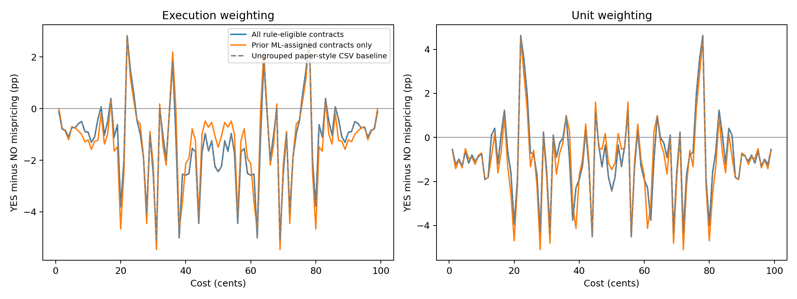
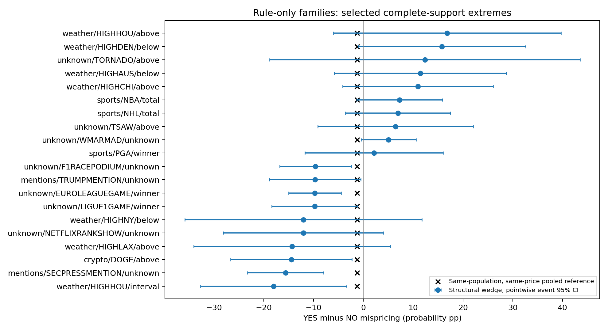

# Rule-only structural groups: YES/NO mispricing results

## Main findings

This rerun uses **no TF-IDF, LSA, sentence embeddings, k-means, or hierarchical clustering**.
Contracts are grouped only by the existing rules: **domain → underlying → contract structure**.
Those rules were recomputed directly from the master market CSV's titles, YES subtitles and event-series codes.

The full structural population contains **266,517 resolved contracts**
across **2991 rule-defined families**, many of them sparse series-fallback groups.
**111 families** have adequate primary price support; **75** support every cost from 1–49¢.
The complete-support families' observed execution-weighted wedges range from
**-18.02 to 16.83 pp**.

The direct common-support equality test **shows borderline evidence of unequal structural-family wedges**:
event-level p = **0.0472**, market-level p = **0.0528**.
The corresponding unit-weighted event-level p-value is **0.0320**.
These are exploratory normal/Gaussian-approximation tests conditional on rules, support and observed outcomes.
A p-value near 0.05 is suggestive rather than decisive, particularly across the multiple sensitivity checks.
Direct equality tests use 100,000 Gaussian draws to reduce Monte Carlo error near that threshold.

Against the matched pooled reference, **7** families pass event FDR 5%,
**6** pass market FDR 5%, and **4** pass event max-T 5%.
**3** pass both event max-T and market FDR with nonzero estimated family variance.
Raw counts can include boundary-win-rate cases; zero variance is not proof of precision.

## What differs from the original paper?

The original paper reports a pooled YES disadvantage at matched purchase costs.
That general pattern remains in this CSV subset. Our extension asks whether the wedge differs
across economic contract families; the original pooled curve does not answer that question.
Exact magnitudes need not reproduce its full-history figures because this is a recent-year
CSV extract, with explicit validation and a different mix of markets.

There are two distinct extensions: **structural-family differences** and **additional differences
between learned subclusters within one structural family**. Evidence for the former would not
establish the latter. The previous primary learned-subcluster within-family test had p=0.8659;
its secondary unit-weighted version had p=0.0287. Neither is a forecast-performance comparison.

## Isolate grouping from selection

The primary population includes all rule-eligible contracts, including those that the ML pipeline
left unassigned for distance, sparse training support, or unseen training families. Family eligibility
does not depend on a learned centroid or training-set coverage. Unknown categories are retained under
explicit unknown/series-fallback families rather than invented labels.

A second run uses **exactly the previous ML-assigned contract population**, with all its learned
cluster IDs replaced by structural family IDs. This controls the contract/trade population when
comparing grouping resolutions. The learned labels determine only this clearly labeled sensitivity's
population membership; they do not determine any structural family or distance.

| population | contracts | events | executions | units | structural_groups |
| --- | --- | --- | --- | --- | --- |
| all_structural | 266517 | 49843 | 60293601 | 15,100,842,364.000 | 2991 |
| same_ml_population | 238601 | 45476 | 52427659 | 13,298,457,214.000 | 139 |

Both populations use the same cached, audited execution sufficient statistics from the master CSVs.
The program verifies CSV file fingerprints before reuse and recomputes structural attributes afresh.
No raw Parquets or MVP code/data are used.

The ungrouped equal-cost mean wedge over 1–49¢ is:

| population | weighting | equal_cost_wedge_pp |
| --- | --- | --- |
| all_structural | execution | -1.225 |
| all_structural | unit | -0.855 |
| same_ml_population | execution | -1.235 |
| same_ml_population | unit | -1.019 |



## Compare the grouping resolutions

The table tests equality of equal-cost wedges among groups with complete 1–49¢ support.
Its null is equal group-level wedges, not zero mispricing and not equality of each group's exact-price curve.

| grouping | weighting | dependence | complete_support_groups | equal_wedge_p |
| --- | --- | --- | --- | --- |
| Learned subclusters, prior assigned population | execution | event_id | 211 | 0.093 |
| Structural families, all eligible | execution | event_id | 75 | 0.047 |
| Structural families, prior assigned population | execution | event_id | 73 | 0.037 |
| Learned subclusters, prior assigned population | execution | ticker | 211 | 0.172 |
| Structural families, all eligible | execution | ticker | 75 | 0.053 |
| Structural families, prior assigned population | execution | ticker | 73 | 0.071 |
| Learned subclusters, prior assigned population | unit | event_id | 211 | 0.059 |
| Structural families, all eligible | unit | event_id | 75 | 0.032 |
| Structural families, prior assigned population | unit | event_id | 73 | 0.024 |
| Learned subclusters, prior assigned population | unit | ticker | 211 | 0.059 |
| Structural families, all eligible | unit | ticker | 75 | 0.047 |
| Structural families, prior assigned population | unit | ticker | 73 | 0.036 |

Even when contracts are matched, the complete-support cohorts and number of groups can differ:
aggregating subclusters changes support and statistical power. These are transparent sensitivity
comparisons, not a paired model-selection test proving that one grouping approach is superior.
Market/event dependence, unit weighting and repeated exploratory checks also affect interpretation.

## Which structural groups differ?



The figure selects extreme observed levels among complete-support families. Its intervals are pointwise,
not simultaneous. The following table instead orders primary comparisons by event-adjusted max-T p-value;
its support can vary by family, so the pooled reference always uses the same costs as that family.

| cluster | contracts | events | n_costs | wedge_pp | pooled_matched_pp | difference_pp | se_event_pp | q_event | q_market | p_event_maxT |
| --- | --- | --- | --- | --- | --- | --- | --- | --- | --- | --- |
| sports/NFLFIRSTTD/unknown | 2111 | 170 | 13 | -23.541 | -1.338 | -22.202 | 3.727 | 0.000 | 0.000 | 0.000 |
| sports/NFLANYTD/unknown | 2887 | 170 | 48 | -16.021 | -1.237 | -14.784 | 3.668 | 0.003 | 0.004 | 0.008 |
| sports/NFLWINS/above | 136 | 32 | 12 | 0.000 | -0.744 | 0.744 | 0.000 | 0.007 | 0.541 | 0.026 |
| mentions/SECPRESSMENTION/unknown | 894 | 42 | 49 | -15.607 | -1.225 | -14.382 | 3.896 | 0.007 | 0.016 | 0.029 |
| sports/NFL2TD/unknown | 813 | 165 | 18 | -27.630 | -1.423 | -26.207 | 7.650 | 0.014 | 0.076 | 0.073 |
| sports/NHL/spread | 947 | 237 | 36 | -20.972 | -1.310 | -19.662 | 5.916 | 0.017 | 0.005 | 0.102 |
| unknown/EUROLEAGUEGAME/winner | 46 | 23 | 49 | -9.723 | -1.225 | -8.498 | 2.699 | 0.029 | 0.992 | 0.194 |
| unknown/SHIBAD/above | 574 | 226 | 47 | 20.168 | -1.235 | 21.403 | 8.698 | 0.194 | 0.004 | 0.788 |
| unknown/F1RACEPODIUM/unknown | 298 | 20 | 49 | -9.616 | -1.225 | -8.391 | 3.668 | 0.264 | 0.992 | 0.923 |
| weather/HIGHHOU/interval | 239 | 65 | 49 | -18.019 | -1.225 | -16.794 | 7.483 | 0.264 | 0.429 | 0.941 |
| unknown/WMARMAD/unknown | 139 | 66 | 49 | 5.062 | -1.225 | 6.287 | 2.811 | 0.264 | 0.992 | 0.949 |
| unknown/AAAGASM/above | 88 | 12 | 26 | -19.978 | -0.860 | -19.118 | 8.937 | 0.264 | 0.409 | 0.971 |

Negative wedge means YES underperforms equally priced NO; positive means the reverse.
The units are probability percentage points, not return percentages or net trading profit.
At one cent a one-point calibration error is a 100% gross return error; the same translation
does not hold at other costs.

## Method and inference

The paper's estimator is retained: realized payoff frequency minus cost/100 for each direction
at each exact cost, then YES minus NO. Every valid execution contributes one complementary position
in each direction, pooling maker and taker roles. Primary weighting is execution count; the
sensitivity uses traded units. Finalized binary YES/NO markets need at least $100 observed notional
(sum of traded units). This is an observed-window screen, not a full-history notional reconstruction.

Structural rules are in `../features.py`; they recognize selected domains/underlyings and spreads,
totals, intervals, above/below thresholds and winners, falling back to series where appropriate.
They are heuristic economic families, not verified settlement equivalence or authoritative taxonomy.
No numerical date/strike-distance metric or probabilistic encoder is used.

A cost contributes only with at least 20 contracts and 10 event IDs **in each direction**.
The primary equal-cost average spans supported 1–49¢ costs, requiring at least 10. Full-population
secondary bands require six supported costs each. The 51–99¢ wedge mirrors 1–49¢ exactly under
all-side pooling; 50¢ is a special calibration case and is omitted from the summary. Full curves
are still saved. Missing support is not zero mispricing.

Clustered sandwich errors aggregate all positions at event ID or market ticker, preserving
within-unit dependence. Cluster-minus-pool variance uses paired influences, including overlap.
Benjamini–Hochberg adjusts within a weighting/population/band family; the joint Gaussian max-T
check uses correlated comparisons and 10,000 draws, seed 340. The direct equality check uses 100,000 draws and centers
complete-support family wedges around their unweighted mean and uses their joint covariance.
See [the earlier methodology](FINDINGS.md) for equations and limitations.

All per-band matched-reference tests:

| population | weighting | band | clusters | global_maxT_p | maxT_critical | event_fdr_05 | market_fdr_05 | maxT_05 | full_support_clusters |
| --- | --- | --- | --- | --- | --- | --- | --- | --- | --- |
| all_structural | execution | 1-49 | 111 | 0.000 | 3.520 | 7 | 6 | 4 | 75 |
| all_structural | execution | 1-10 | 100 | 0.000 | 3.496 | 14 | 9 | 7 | 85 |
| all_structural | execution | 11-20 | 99 | 0.000 | 3.477 | 1 | 2 | 1 | 90 |
| all_structural | execution | 21-30 | 98 | 0.403 | 3.472 | 0 | 1 | 0 | 91 |
| all_structural | execution | 31-40 | 101 | 0.023 | 3.483 | 2 | 1 | 2 | 94 |
| all_structural | execution | 41-49 | 98 | 0.394 | 3.506 | 0 | 0 | 0 | 93 |
| all_structural | unit | 1-49 | 111 | 0.016 | 3.529 | 3 | 2 | 2 | 75 |
| all_structural | unit | 1-10 | 100 | 0.000 | 3.481 | 3 | 2 | 1 | 85 |
| all_structural | unit | 11-20 | 99 | 0.309 | 3.478 | 0 | 1 | 0 | 90 |
| all_structural | unit | 21-30 | 98 | 0.155 | 3.476 | 0 | 1 | 0 | 91 |
| all_structural | unit | 31-40 | 101 | 0.049 | 3.485 | 1 | 1 | 1 | 94 |
| all_structural | unit | 41-49 | 98 | 0.071 | 3.462 | 2 | 1 | 0 | 93 |
| same_ml_population | execution | 1-49 | 103 | 0.000 | 3.485 | 6 | 5 | 4 | 73 |
| same_ml_population | unit | 1-49 | 103 | 0.019 | 3.498 | 2 | 0 | 1 | 73 |

All direct complete-support equality checks:

| population | weighting | dependence_unit | p_value | observed_max_z | tested_groups |
| --- | --- | --- | --- | --- | --- |
| all_structural | execution | event_id | 0.047 | 3.408 | 75 |
| all_structural | execution | ticker | 0.053 | 3.378 | 75 |
| all_structural | unit | event_id | 0.032 | 3.516 | 75 |
| all_structural | unit | ticker | 0.047 | 3.414 | 75 |
| same_ml_population | execution | event_id | 0.037 | 3.479 | 73 |
| same_ml_population | execution | ticker | 0.071 | 3.286 | 73 |
| same_ml_population | unit | event_id | 0.024 | 3.588 | 73 |
| same_ml_population | unit | ticker | 0.036 | 3.486 | 73 |

The tests are not jointly corrected across every population, weighting and band; secondary positive
results require independent confirmation. Boundary win rates, concentrated weights, related events
with different IDs, and the selected resolved population can undermine asymptotic inference.
Similarity or structural grouping cannot eliminate sampling noise or identify a causal wording effect.

## Reproduce and inspect

```bash
# Requires the audited baseline statistics from the previous analysis.
.venv/bin/python -m src.analysis.kalshi.clustering.mispricing.structural
```

The new results are under `results/structural/`; the learned-cluster results remain intact.
`structural_assignments.csv` contains fresh rule-only assignments, `structural_summary.csv`
contains supports and uncertainty, and exact-price curves retain every contributing family.
`run_manifest.json` records inputs, source hashes, versions and completion. This report and
its figures are separate reviewable outputs alongside the previous report.
